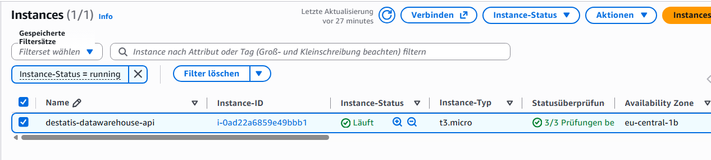
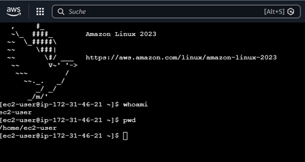
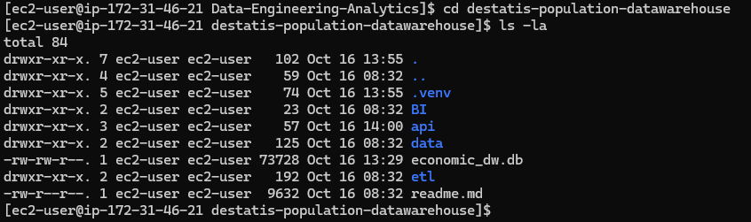
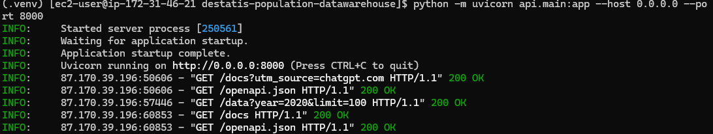
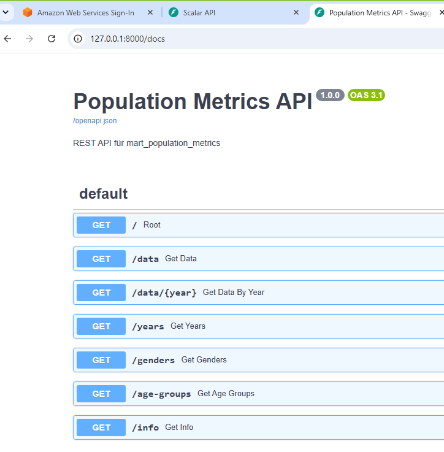
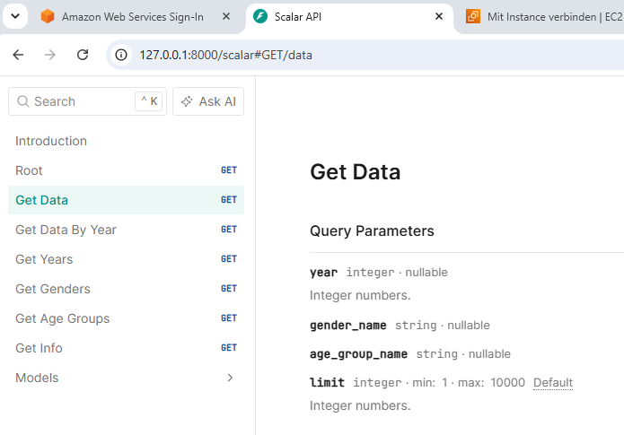
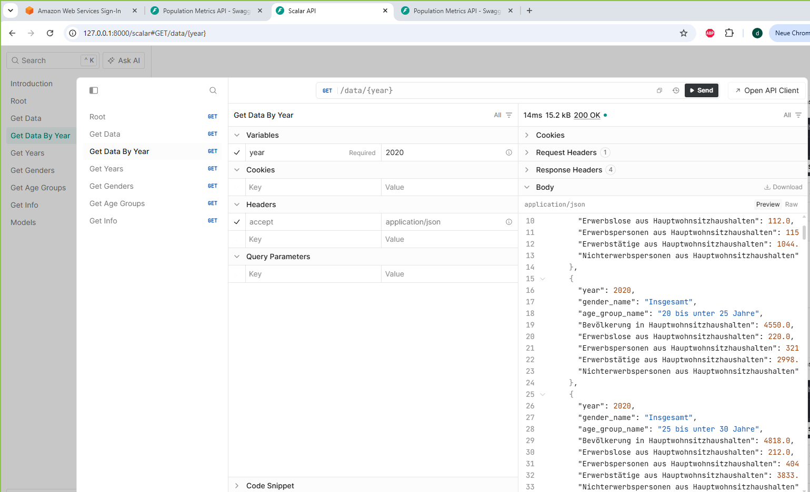
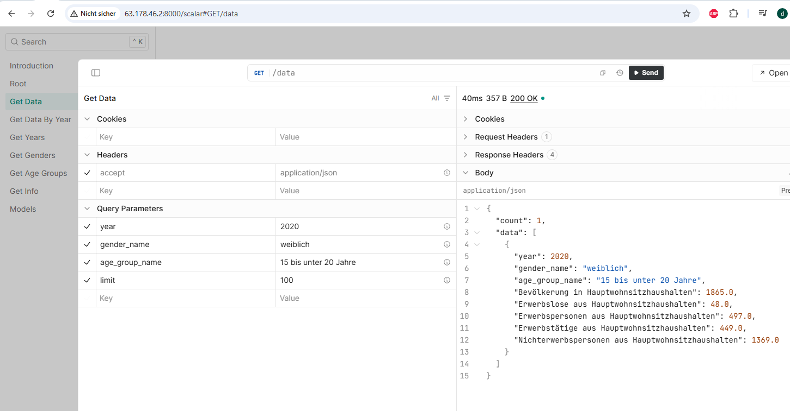

# AWS EC2 Cloud Deployment

## 1. Project Overview

This document describes the cloud deployment of the **Destatis
Population Data Warehouse** REST API on an Amazon EC2 Linux instance.

The project extends the existing data engineering pipeline with a
remotely accessible API. The SQLite database `economic_dw.db` is created
by the project's ETL and data warehouse processes and is used by the
FastAPI application to serve analytical population data.

### Deployment status

The following components have been implemented and tested:

-   [x] Amazon EC2 instance running Amazon Linux 2023
-   [x] SSH access from Windows PowerShell
-   [x] Python virtual environment
-   [x] SQLite database deployed to the project directory
-   [x] FastAPI application started with Uvicorn
-   [x] API documentation accessible through `/docs`
-   [x] API data endpoint tested successfully
-   [ ] Persistent service configuration (for example, systemd)
-   [ ] HTTPS and production-grade access protection
-   [ ] Power BI integration documentation

> **Important:** The current deployment is a portfolio/demo setup.
> Uvicorn was started in the foreground in an SSH session. The API may
> stop when that process or session ends. This is not yet a production
> deployment.

## 2. Architecture

``` text
Destatis Open Data
       |
       v
Python ETL Pipeline
       |
       v
SQLite Data Warehouse
economic_dw.db
       |
       v
Population Metrics Data Mart
       |
       v
FastAPI Application
       |
       v
Uvicorn ASGI Server
       |
       v
AWS EC2 - Amazon Linux 2023
       |
       v
HTTP REST API / JSON
       |
       v
Client / API documentation / future Power BI integration
```

The API application is located in `api/main.py`. The application uses
the SQLite database `economic_dw.db` and the `mart_population_metrics`
table/view configured in the application.

## 3. AWS Infrastructure
```
  Setting                Configuration
  ---------------------- ------------------------------------
  Cloud provider         Amazon Web Services (AWS)
  Service                Amazon EC2
  Operating system       Amazon Linux 2023
  Region                 Europe (Frankfurt), `eu-central-1`
  Linux user             `ec2-user`
  Application protocol   HTTP
  Application port       `8000`
  API framework          FastAPI
  ASGI server            Uvicorn
  Database               SQLite
```

The instance's public IPv4 address can change after a stop/start
operation unless an Elastic IP is assigned. For that reason, the public
IP address is intentionally not hard-coded in this document.

## 4. Connect to EC2 from Windows

The SSH private key is stored locally on the Windows computer and must
not be committed to GitHub.

Open **Windows PowerShell** and connect using:

``` powershell
ssh -i "C:\AWS\destatis-ec2-key.pem" ec2-user@<EC2_PUBLIC_IP>
```

Replace `<EC2_PUBLIC_IP>` with the current public IPv4 address of the
EC2 instance.


If Windows reports that the private key permissions are too open,
restrict access to the key file. Do not upload or share the private key.

## 5. Project Location on EC2

#### transfert economic_dw.db from Windows to EC2
To do this, **open a new Windows PowerShell window on your PC** —not the EC2 terminal.
```text
scp -i "C:\Pfad\zu\deinem-schluessel.pem" "C:\Pfad\zu\economic_dw.db" ec2-user@DEINE-EC2-IP:/home/ec2-user/destatis-population-datawarehouse/
```
Replace the placeholders with your actual paths and the IP address from the AWS console.

The project was deployed in the following directory:

``` bash
/home/ec2-user/Data-Engineering-Analytics/destatis-population-datawarehouse
```

#### Change to the project directory:

``` bash
cd /home/ec2-user/Data-Engineering-Analytics/destatis-population-datawarehouse
ls -la
```


The SQLite database file must be present at the path expected by the
application. In this project, the application configures the database
name as `economic_dw.db`; therefore, starting Uvicorn from the project
directory ensures that the relative database path resolves as expected.

## 6. Python Environment

#### Python installation
``` bash
sudo dnf install -y python3 python3-pip git
```
#### Installation check

``` bash
python3 --version
pip3 --version
git --version
```
#### Python-Environment preparation

``` bash
python3 -m venv .venv
source .venv/bin/activate
python --version
```
Activate the existing virtual environment:

The shell prompt should then show `(.venv)`.

## 7. Start the FastAPI Application

From the project directory, with the virtual environment activated,
start the API:

``` bash
python -m uvicorn api.main:app --host 0.0.0.0 --port 8000
```

Expected startup messages include:

``` text
INFO:     Started server process
INFO:     Waiting for application startup.
INFO:     Application startup complete.
INFO:     Uvicorn running on http://0.0.0.0:8000
```

The option `--host 0.0.0.0` makes Uvicorn listen on all IPv4 network
interfaces. It does not, by itself, make the service publicly
accessible; AWS network rules and any host firewall must also permit the
connection.


Keep the terminal running while testing. Pressing `Ctrl+C` stops
Uvicorn.

## 8. AWS Security Group

The EC2 security group controls inbound network traffic to the instance.

For this test deployment, configure only the inbound rules that are
required:

  ------------------------------------------------------------------------
  Purpose          Protocol                          Port Recommended
                                                          source
  ---------------- ---------------- --------------------- ----------------
  SSH              TCP                                 22 Your trusted
  administration                                          public IP
                                                          address with
                                                          `/32`

  API testing      TCP                               8000 Your trusted
                                                          public IP
                                                          address with
                                                          `/32`
  ------------------------------------------------------------------------

Do not expose SSH or the API port to `0.0.0.0/0` unless there is a
deliberate, reviewed reason to do so. Restrict access to trusted
sources.

For browser-based EC2 Instance Connect, AWS may require an additional
SSH inbound rule using the regional EC2 Instance Connect managed prefix
list. This is separate from the SSH rule used by a direct connection
from Windows PowerShell. Consult the AWS documentation for the selected
region and connection method.

## 9. Test the Deployment

### 9.1 Check the listening port on EC2

Run this command in a second SSH session:

``` bash
sudo ss -lntp | grep ':8000'
```

A successful result should show a listening socket on `0.0.0.0:8000` (or
another intentionally configured externally reachable interface).

### 9.2 Test the API locally on EC2

``` bash
curl -I http://127.0.0.1:8000/docs
```

A successful response should include:

``` text
HTTP/1.1 200 OK
```

### 9.3 Test connectivity from Windows

In Windows PowerShell:

``` powershell
Test-NetConnection <EC2_PUBLIC_IP> -Port 8000
```

A successful TCP connection is indicated by:

``` text
TcpTestSucceeded : True
```

### 9.4 Open the interactive API documentation

In a browser, open:

``` text
http://<EC2_PUBLIC_IP>:8000/docs
```

FastAPI provides an interactive Swagger UI at `/docs` and an OpenAPI
specification at `/openapi.json`.

``` text
http://<EC2_PUBLIC_IP>:8000/scalar
```


### 9.5 Test a data endpoint

Example request:

``` text
http://<EC2_PUBLIC_IP>:8000/data?year=2020&limit=10
```




The endpoint returned HTTP `200 OK` during the deployment test. The
response contains JSON data supplied by the API. The exact response
fields depend on the current implementation.

## 10. Troubleshooting Notes

### API works on `127.0.0.1` but not through the public IP

Check the following in order:

1.  Confirm that Uvicorn is running.
2.  Confirm that Uvicorn was started with `--host 0.0.0.0`.
3.  Check that the EC2 security group allows inbound TCP traffic on port
    `8000` from the testing computer's current public IP address.
4.  Confirm that the public IPv4 address shown in the EC2 console is
    still current.
5.  From Windows, run `Test-NetConnection <EC2_PUBLIC_IP> -Port 8000`.

A successful local HTTP test alone does not prove that the service is
reachable from the internet.

### Check whether Uvicorn is running

``` bash
sudo ss -lntp | grep ':8000'
```

If no process is listening, change to the project directory, activate
the virtual environment and start Uvicorn again using the command in
Section 7.

### SSH access

For direct SSH from Windows PowerShell, check that the security group
permits TCP port `22` from the current public IP address of the client.
Browser-based EC2 Instance Connect has separate network requirements.

### transfert database economic_dw.db from Windows to EC2
If the transfer doesn't work via SSH, you may need to correct the permissions in PowerShell.
Run these commands in your current PowerShell window:
```text
$key = "C:\AWS\destatis-ec2-key.pem"

icacls $key /inheritance:r
icacls $key /remove "BUILTIN\Users"
icacls $key /remove "NT AUTHORITY\Authenticated Users"
icacls $key /remove "Everyone"
icacls $key /grant:r "$($env:USERNAME):(R)"
```

## 11. Current Limitations and Next Steps

This deployment demonstrates how to host a Python REST API on a cloud
Linux server. The following improvements are recommended before
production use:

-   Configure Uvicorn to run as a managed service (for example, with
    `systemd`) and define restart behavior.
-   Put a reverse proxy such as Nginx in front of the application.
-   Configure HTTPS with a valid TLS certificate.
-   Add authentication and authorization if the API should not be
    public.
-   Keep inbound security group rules restricted to the required
    sources.
-   Add application logging, monitoring and backup procedures.
-   Define a repeatable deployment process and dependency versions.
-   Document and test the Power BI connection to the API.

## 12. Security

-   Never commit `.pem` private keys, AWS credentials, passwords, tokens
    or `.env` files to GitHub.
-   Do not publish secrets in screenshots, terminal output or
    documentation.
-   Avoid exposing port `8000` publicly without a clear access-control
    strategy.
-   Use HTTPS before transmitting non-public data or credentials.
-   Review the contents of `economic_dw.db` before committing it. Only
    publish the database if it contains data that is safe to share and
    its size and licensing are appropriate.

## 13. References

-   [Amazon EC2 User
    Guide](https://docs.aws.amazon.com/AWSEC2/latest/UserGuide/concepts.html)
-   [Connect to a Linux instance using
    SSH](https://docs.aws.amazon.com/AWSEC2/latest/UserGuide/connect-linux-inst-ssh.html)
-   [EC2 Instance
    Connect](https://docs.aws.amazon.com/AWSEC2/latest/UserGuide/ec2-instance-connect-methods.html)
-   [FastAPI documentation](https://fastapi.tiangolo.com/)
-   [Uvicorn documentation](https://www.uvicorn.org/)
